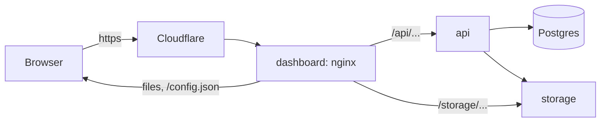

# Architecture

How the parts of the product fit together.

## 1. A modular monolith

The API is one .NET 10 process made of modules. Each module is a bounded context with its own entities, its own `DbContext` and its own endpoints under `/api/v1/<module>`, built as vertical slices: one folder per feature, with its command or query, handler, validator and endpoint. Modules talk to each other only through each other's `.Contracts` project, or through integration events with an outbox in Postgres. The building blocks in `src/BuildingBlocks` give every module the same persistence, caching, eventing, jobs, mail, storage, quotas and web conventions. [modules.md](modules.md) lists the modules.

Every tenant's data is in the same database, kept apart by a tenant column that EF Core filters on in every query. A request names its tenant in the `tenant` header, and a user signs in within one tenant.

## 2. Images and apps

The repository builds four images, listed in `platform.yaml`. Each Environment runs them as three apps of one stamp, a Container Apps environment in Azure:

| Image | Built from | Runs as | What it does |
| --- | --- | --- | --- |
| `dashboard` | `clients/dashboard/Dockerfile`, context `clients/dashboard` | The app `dashboard`, with the stamp's default hostname | nginx serving the tenant app on port 8080, and passing `/api` to the API and `/storage` to the storage |
| `admin` | `clients/admin/Dockerfile`, context `clients/admin` | The app `admin`, with a hostname of its own | nginx serving the operator console, with the same proxies |
| `api` | `src/Host/App.Api/Dockerfile` | The app `api`, with internal ingress and no hostname | The API on port 8080 |
| `migrator` | `src/Host/App.DbMigrator/Dockerfile` | The init container of `api` | Migrates and seeds the database, then exits |

Every image runs as a non-root user, and every base image is pinned by digest. The three apps listen on port 8080 and answer `/healthz` and `/readyz`, which the platform probes. The API is ready only while its database checks pass, and the cache's too when it has one.

## 3. Backing services

The backing services come from the stamp, not from this repository. Each is an entry under `data` in the stamp's `stamp.yaml`, and the app gets the same setting whoever runs it ([configuration.md](configuration.md)):

| Service | In a dev stamp | Setting | Without it |
| --- | --- | --- | --- |
| `postgres` | A container, `ca-<stamp>-postgres`; Neon where the stamp chooses it | `DATABASE_URL` | Nothing starts |
| `storage` | A container, `ca-<stamp>-storage`, S3-compatible | `S3_*` | Files go to the replica's disk and are lost on restart |
| `cache` | Not in a dev stamp yet; a Valkey container or Upstash when the stamp adds it | `REDIS_URL` | An in-memory cache in each replica |
| `messaging` | A RabbitMQ container when the stamp adds it | `MESSAGING_URL` | Events stay inside the replica, with the outbox in Postgres |

A container service keeps its data only while it runs: after a restart, the migrator and the seed data build the database again. Where the stamp chooses a managed service, such as Neon, the data stays.

## 4. The migrator

`migrator` runs before `api`, in every replica of every new revision (`src/Host/App.DbMigrator/Program.cs`):

1. It waits for Postgres, then takes a Postgres advisory lock (`PostgresMigratorLock.cs`), so only one replica migrates at a time.
2. It applies the tenant catalog's migrations, and seeds the root tenant the first time.
3. It creates the storage bucket where it is missing; a stamp's storage service has already created it.
4. For every tenant, it applies each module's migrations and the seed data: roles, groups, and the tenant's admin user. The root tenant's admin, `admin@root.com`, gets `SEED_ADMIN_PASSWORD`; without it, no admin user is seeded.
5. Where `SEED_DEMO` is true, it seeds the demo tenants `acme` and `globex` with users, products, tickets and chat (`DemoSeed/`).
6. It exits. Then `api` starts.

The other replicas wait for the lock, find nothing left to do and exit. When the migrator fails, the new revision never becomes ready, and the previous revision keeps serving. So a revision never serves on a database it doesn't know.

The migrations are in `src/Host/App.Migrations.PostgreSQL`, one folder per module. The previous revision runs on the migrated database until the new one is ready, so every migration must be backward compatible ([deployment.md](deployment.md)).

## 5. A request, from the browser to the database

- The browser talks only to a front end, on its hostname, through Cloudflare. In a sandbox, Cloudflare Access asks for a sign-in first; one Access application covers the front end, its API and its files.
- nginx answers the files of the React build. A path that isn't a file gets `index.html`, and the router in the browser shows the page.
- nginx passes every request under `/api` to `api`, at `http://ca-<stamp>-api` inside the stamp, with the path unchanged, and streams the answer, so server-sent events and the SignalR hub work. The page and the API share one origin, so the API needs no CORS settings.
- Files go straight between the browser and the storage, through `/storage`: the API hands out presigned URLs on the page's own hostname (`S3_PUBLIC_ENDPOINT`), and nginx passes them to `http://ca-<stamp>-storage:9000` with the page's `Host` unchanged, because the signature covers it.
- `api` answers from Postgres, and keeps cached data in its cache.

`admin` works the same way on its own hostname. The sample uses file storage only from `dashboard`, whose hostname is `S3_PUBLIC_ENDPOINT`.

## 6. The front ends

Each front end's `src/main.tsx` loads `/config.json` (`src/env.ts`) before it renders. It holds only `PLATFORM_*` and `PUBLIC_*` settings ([configuration.md](configuration.md)). The apps call the API at the relative path `/api` with `src/lib/api-client.ts`, which adds the JWT and the `tenant` header and refreshes the token once on a `401`. The build writes `dist/`, which the image serves; hashed files under `/assets/` are cached for a year.
