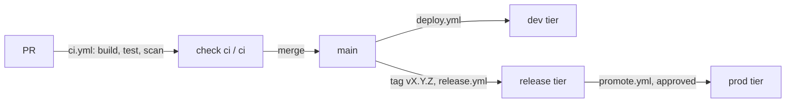

# Deployment

The platform builds the images once for each commit on `main`, and moves those same images, by their digests, from Environment to Environment. Nothing is rebuilt for production. You never deploy by hand and never create infrastructure yourself.

## 1. Environments and tiers

Each Environment of the repository is one stamp: a Container Apps environment with the apps `dashboard`, `admin` and `api` and its backing services, in Azure. Each belongs to a tier:

| Tier | Environments | Gets |
| --- | --- | --- |
| `dev` | `dev`, `<customer>-dev` | Every push to `main` |
| `release` | `test`, `staging`, `uat`, `perf`, `demo`, and their `<customer>-` forms | Every release tag `vX.Y.Z` |
| `prod` | `prod`, `<customer>-prod` | Only a promotion, after the Environment's reviewers approve |

A new repository starts with `dev`. Its first stamp declares the secrets `jwt-signing-key`, `hangfire-password` and `seed-admin-password`, and the backing services `postgres` and `storage`; it runs on the in-memory cache until the stamp adds `cache`. Your team asks for another Environment through the platform team's onboarding form.

## 2. From PR to production



| Step | Workflow | What happens |
| --- | --- | --- |
| Check | `ci.yml`, on every PR and push to `main` | Builds the four images, runs `dotnet test src/App.slnx`, scans the images with Trivy and checks `platform.yaml`. Pushes nothing. The check `ci / ci` must pass before a PR can merge |
| Deploy | `deploy.yml`, on every push to `main` | Builds the images once, scans them, pushes them to the GitHub Container Registry (GHCR) as `sha-<commit>` with their software bills of materials, and deploys them to every `dev` tier Environment |
| Release | `release.yml`, on a tag `vX.Y.Z` on a commit of `main` | Builds nothing. Adds the tag to that commit's images, creates the GitHub Release, and deploys them to every `release` tier Environment |
| Promote | `promote.yml`, by hand with a version and an Environment | Checks that the version runs healthy in a `release` tier Environment, waits for the reviewers, and deploys the same images. Rolling back is promoting the previous version |

This template has only `ci.yml`. The platform team adds `deploy.yml` and `release.yml` next, and `promote.yml` before the first production Environment. In a template repository, `deploy.yml` and `release.yml` skip every job, because a template deploys nowhere. In a repository created from the template they run as above.

Each workflow is a thin caller of a reusable workflow in `tl-platform`, pinned to a tag `app-workflows/v<x.y.z>`. Don't add steps to them: the platform team changes the reusable workflows, and a PR bumps the tag in your repository.

A deploy starts a new revision of each app. In `api`, the migrator runs first ([architecture.md](architecture.md#4-the-migrator)). A revision gets traffic only once `/readyz` answers, which for `api` means its database checks pass too, and the previous revision keeps serving until then. A deploy that fails leaves the Environment on the version it had.

## 3. Migrations

The previous revision of `api` keeps serving on the migrated database until the new one is ready, and a rollback never reverses a migration. So every migration is backward compatible, in two steps:

1. One release adds what the new code needs, such as a column or a table, and the code works with and without it.
2. A later release drops what the code has stopped using.

Each module has its own `DbContext`, and its migrations are in its folder of `src/Host/App.Migrations.PostgreSQL`. To add one, change the module's model and run:

```sh
dotnet tool restore
dotnet ef migrations add <Name> \
  --project src/Host/App.Migrations.PostgreSQL \
  --startup-project src/Host/App.Api \
  --context <Module>DbContext \
  --output-dir <Module>
```

Commit the files it writes. The AppHost and `docker compose up --build` apply it locally, through the migrator, as every deploy does. Answer "Is the migration backward compatible?" in the PR. `.agents/skills/create-migration/SKILL.md` has the details, such as how to review the SQL first.

## 4. Images

Images are stored in GHCR as `ghcr.io/trislabcompany/<repository>/api`, `…/migrator`, `…/admin` and `…/dashboard`. They are private, also when the repository is public. The stamps pull them with the platform's pull token. You don't need to do anything for this.

Trivy scans the images in every workflow. It fails on any secret in an image, and on a CRITICAL or HIGH vulnerability that has a fix. To accept a finding, add its ID to `.trivyignore` with a reason and an expiry date on the line above it; `devops` reviews that change.

## 5. `platform.yaml` and the caps

`platform.yaml` says which images the repository builds and how each app is sized:

| Field | `dashboard`, `admin` | `api` | Meaning |
| --- | --- | --- | --- |
| `image` | `dashboard`, `admin` | `api` | The app's container, from `images` |
| `init_image` | | `migrator` | Runs to completion before the app's container starts, in every replica |
| `profile` | `Consumption` | `Consumption` | Serverless: you pay per use, and the app can scale to zero |
| `cpu` | `0.25` | `0.5` | vCPU per replica, in steps of 0.25 |
| `memory` | `0.5Gi` | `1Gi` | Memory per replica. On `Consumption` it must be twice the CPU in Gi |
| `min_replicas` | `0` | `0` | No replica while nobody uses the app; the first request starts one |
| `max_replicas` | `2` | `2` | At most two replicas under load |

Each stamp has caps: the most each app may use. A sandbox stamp's default caps are `Consumption` only, 0.5 vCPU, `1Gi` and at most two replicas, and this file stays within them. `ci / ci` checks `platform.yaml` against the caps of every Environment on each PR in a repository created from the template, so a PR above a cap never merges. Each deploy checks again.

With more than one replica of `api`, give the stamp a cache: without one, each replica has its own in-memory cache, its own SignalR connections and its own data protection keys.

To size one Environment differently, add an override under `environments`, within that Environment's caps:

```yaml
environments:
  prod:
    api: { min_replicas: 1, max_replicas: 4 }
```

## 6. Choosing a backing service

Each Environment is a stamp in `tl-cloud-infrastructure`, under `stamps/<landing zone>/<folder>/stamp.yaml`, and each stamp chooses its own backing services under `data`. A service is a container in the stamp by default; some can be a managed service instead:

| You need | Change in `stamp.yaml` | Needs the platform team first |
| --- | --- | --- |
| A cache | `data.cache: {}` | No |
| A managed cache | `data.cache.provider: upstash` | Yes: the Upstash database |
| Messaging | `data.messaging: {}` | No |
| Neon instead of the Postgres container | `data.postgres.provider: neon` | Yes: the Neon project |
| More CPU or memory for a service | `data.<service>.cpu` and `memory` | No |

The app needs no change: it gets the service's setting, such as `REDIS_URL`, and `PlatformConfiguration.cs` already maps it ([configuration.md](configuration.md)). A typical product runs every service as a container in `dev`, and moves Postgres to Neon in `test` to test against the production service. Moving a service from a container to a managed provider starts it empty: the migrator builds the schema, and data the Environment must keep is copied by hand before the switch.

## 7. Asking for more

Raising a cap, adding an Environment, a setting, a secret or a custom domain is a change to the stamp, not to this repository:

| You need | Change in `stamp.yaml` |
| --- | --- |
| More CPU, memory or replicas | `apps[].caps` of the app |
| A setting | `apps[].env` of the app ([configuration.md](configuration.md)) |
| A secret | `apps[].secrets` of the app; an engineer sets the value |
| A public hostname for the API, for mobile clients or webhooks | `ingress: external` on `api`; the API then handles CORS itself |

Your team may open these PRs: the stamp's folder lists your team as a code owner next to the platform team. The infrastructure pipeline plans the change, the platform team approves the apply, and the next deploy can use it. For an Environment or a custom domain, ask the platform team.
